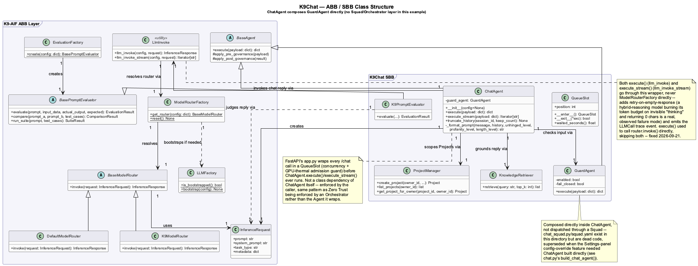

# K9Chat Example

K9Chat is a lightweight example application built on the **K9-AIF Framework**.

It demonstrates how a simple chat experience can be implemented using K9-AIF building blocks while remaining configuration-driven and model-provider agnostic.

This example showcases:

- ABB / SBB architectural separation (`ChatAgent`/`GuardAgent` extend `BaseAgent`; composed directly, not dispatched via a Squad/Orchestrator — see the class diagram note)
- Model routing via **llm_invoke** (retry-on-empty-response + trace events), which resolves **ModelRouterFactory**/**K9ModelRouter** internally — agent code itself never touches the router directly
- Integration with LLM providers (for example **Ollama**)
- Real-time knowledge grounding (ChromaDB, `knowledge_retriever.py`/`seed_knowledge_base.py`) plus per-visitor **Projects** (own document collections, `project_manager.py`/`project_retriever.py`)
- Guest identity with no password (`auth.py`) — every visitor gets a display name/codename, scoping Projects per-visitor without gating access
- A real concurrency + GPU-thermal admission guard (`queue_control.py`/`gpu_telemetry.py`) protecting the backing GPU host from being overrun
- Toggleable "fun dials" (Unhinged/Profanity/Length), an LLM-as-judge **Eval** toggle, and a **Streaming** toggle — all genuinely wired, not decorative
- Ubuntu/Podman container deployment (`ubuntu/`)

## Quick start (local, no container)

```
git clone https://github.com/k9aif/examples.git k9-aif-examples
cd k9-aif-examples
k9chat/setup.sh          # creates k9chat/.venv, installs requirements.txt + k9-aif from PyPI
# edit k9chat/.env: OLLAMA_BASE_URL and the model names you have pulled
k9chat/setup.sh seed     # one time: load the knowledge base
k9chat/setup.sh run      # http://localhost:7777
```

`setup.sh` uses Python 3.11+ (set `PYTHON=` to pick one), installs a
CPU-only PyTorch (only the FAQ reranker needs it), then the pinned
`requirements.txt`, then `k9-aif` from PyPI with `--no-deps` so the pins
stay put. Without a framework checkout, `seed` loads K9Chat's own FAQ and
glossary; clone the framework next to this repo to include its docs too.

## Setup (framework from source)

If a [k9-aif-framework](https://github.com/k9aif/k9-aif-framework) checkout
sits next to this repo, k9chat imports `k9_aif_abb/` from that source
instead of the PyPI package (the container build does this), so framework
changes are picked up without a release. Layout:

```
some-parent-dir/
├── k9-aif-examples/   (this repo)
│   └── k9chat/
└── k9-aif-framework/
```

Override the expected location with `K9AIF_FRAMEWORK_PATH` if the two
repos aren't siblings under the same parent.

---

## Class Diagram

The following class diagram illustrates the core K9Chat object-oriented structure and shows how the example uses K9-AIF abstractions such as `BaseAgent`, `LlmInvoke` (the only sanctioned path to `ModelRouterFactory`/`BaseModelRouter`), `InferenceRequest`, and `BasePromptEvaluator`. PlantUML source: [`diagrams/k9-chat-class-diagram.puml`](diagrams/k9-chat-class-diagram.puml).



---


## Contents

- `chat.py` — Shared chat backend logic (session/history, Projects wiring, Eval/Streaming toggles); builds `ChatAgent` directly (see `build_chat_agent()`'s docstring for why)
- `app.py` — FastAPI browser UI: routes, SSE streaming, `QueueSlot`-guarded `/chat` endpoints
- `chat_agent.py` — `ChatAgent`, the one real agent in this example; composes `GuardAgent` and applies the fun-dial/scope prompt instructions
- `guard_agent.py` — `GuardAgent`, pre-inference content-safety check via a guardian model
- `auth.py` — No-password guest identity (display name / generated codename), session-scoped `owner_id`
- `queue_control.py` — Concurrency semaphore (`QueueSlot`) + model-switch cooldown, backing the waitlist widget
- `gpu_telemetry.py` — Real GPU/CPU telemetry proxy + thermal admission guard (default 85°C limit)
- `project_manager.py` / `project_retriever.py` — Per-visitor Projects: metadata (sqlite) and per-project ChromaDB document collections
- `knowledge_retriever.py` / `seed_knowledge_base.py` — The always-on K9-AIF/K9X knowledge base (ChromaDB, `k9x_knowledge_base` collection)
- `provider_settings.py` — Runtime Settings-panel overrides (model, OpenAI-compatible endpoint + key)
- `health_check.py` — `/health` route backing
- `config.yaml` — Configuration for LLM provider, model routing, evaluation, and guardrails
- `squad.yaml` / `chat_squad.py` — **Dead code**, not loaded by anything today; left over from before the Settings-panel override feature required constructing `ChatAgent` directly (bypasses `SquadLoader`/`AgentRegistry`, which would silently drop config overrides)
- `templates/index.html`, `templates/login.html` — Browser UI templates
- `static/js/`, `static/style.css` — Frontend JS (`app.js`, `message_list.js`, `chat_input.js`) and styling
- `knowledge/` — Seed documents for the knowledge base (e.g. `glossary.md`)
- `doc/` — Supporting documentation for the example
- `.env.example` — Full environment template (copy to `.env`, gitignored)

Deployment scripts (`ubuntu/Containerfile`/`build-run.sh`) live alongside this directory — see below.

---

## Requirements

- Python 3.13+
- Virtual environment with K9-AIF dependencies installed
- Additional UI dependencies for browser mode:
  - `fastapi`
  - `uvicorn`
  - `jinja2`

Install UI dependencies if needed:

```bash
pip install fastapi uvicorn jinja2

```
---

## Running K9Chat (Browser UI)

From the root of this repo (k9-aif-examples), with k9-aif-framework cloned
as a sibling (see Setup above):

``` bash
cd k9chat
uvicorn app:app --reload
```

## Running K9Chat (Ubuntu / Podman container)

Deployment scripts live at `ubuntu/`, next to this directory. Build context
is `ai/` (the parent of both this repo and k9-aif-framework), since the
image needs `k9_aif_abb/` and `k9chat/` together.

```bash
cp k9chat/.env.example k9chat/.env   # fill in your own values
k9chat/ubuntu/build-run.sh all       # build + start, port 7777
k9chat/ubuntu/build-run.sh seed      # one-time: seed the knowledge base
k9chat/ubuntu/build-run.sh logs
k9chat/ubuntu/build-run.sh stop
```

`.chroma/` and the Projects sqlite db persist across rebuilds via a bind
mount at `k9chat/data/` on the host. Override the published port with
`HOST_PORT=<port> k9chat/ubuntu/build-run.sh start`.


## Ask API (for other applications)

`api_v1.py` lets another application ask K9Chat a question (K9X Studio's Help, later a question bar on
k9x.ai). It is separate from the browser UI's `/chat`, and off unless `K9CHAT_API_ENABLED=true`. With
`K9CHAT_API_SIMULATED=true` (the default) answers are canned and marked `"simulated": true`.

| Method | Path | |
|---|---|---|
| `POST` | `/api/v1/ask` | question → answer; SSE stream by default, `"stream": false` for one JSON reply |
| `GET` | `/api/v1/ask/options` | the defaults, and which ones this caller may change |
| `GET` | `/api/v1/health` | 200 up / 503 down (cached 15 s), for the k9x dashboard |

```bash
curl -s https://<k9chat-host>/api/v1/ask -H "Authorization: Bearer $K9_KEY_STUDIO" \
  -H 'Content-Type: application/json' \
  -d '{"question": "How do I add a HIL step in Studio?", "options": {"stream": false}}'
```

Request: `question` (required), `session_id` (optional, keeps follow-ups in context), `context` (optional
page context, screened like the question), `options`. Defaults: framework **on**, faq **on**, internet
**off**, stream **on**, eval **off**. Framework and internet are one switch (internet = not framework).
Reply: `answer`, `sources`, `answered_by` (`faq` | `model` | `simulated`), `model`, `session_id`,
`elapsed_ms`, `options_applied`, `simulated`. Stream events: `queued`, `token`, then `done` (the same JSON)
or `error`. Errors: `{"error": {"code", "message"}}` with `unauthorized` 401, `forbidden` /
`option_not_allowed` / `origin_not_allowed` / `challenge_*` 403, `invalid` 400, `too_large` 413,
`blocked` 422 (Shield), `rate_limited` 429, `busy` 503.

Callers (config.yaml `api`):

- **Keyed** (e.g. Studio): `Authorization: Bearer <key>`, checked by the framework's `ApiKeyAuthenticator`.
  The key lives only in `.env` (`K9_KEY_STUDIO`); the caller keeps it server-side, never in browser code.
  `K9_KEY_STUDIO_FROM` optionally pins it to source addresses on the internal path (never via the tunnel).
  Only a key with the `ask_options` role may change framework/internet/eval. Own budget per key.
- **Anonymous** (a browser on k9x.ai): allowed `Origin` plus a Cloudflare Turnstile token
  (`X-Turnstile-Token`, verified server-side including its hostname). Locked to the defaults; per-IP
  budget plus one daily budget for all anonymous callers. `K9CHAT_API_ANONYMOUS=false` turns it off.

Every request is refused as cheaply as possible: size cap → caller → body shape → options → budgets →
FAQ shortcut (CPU) → GPU queue (full = 503 at once) → model. API conversations are kept apart from
browser visitors' (`api-<caller>-<session_id>`), and correction learning never runs for API callers.
Tests: `k9chat/tests/test_api_v1.py`.
