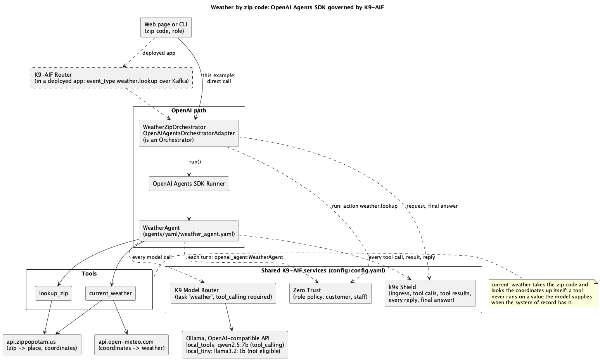

# K9-AIF Framework, K9X Ecosystem and OpenAI Agents SDK in Collaboration

A small application you download and run on your own machine: give it a US zip code, get the current
weather. An **OpenAI Agents SDK** agent does the work. **K9-AIF** governs every step: Zero Trust for the
caller and the agent, k9x Shield on the request, every tool call, every tool result, every model reply and
the final answer, and the **K9 Model Router** choosing the model for every call.

No OpenAI API key is needed: the SDK talks to your Ollama server through its OpenAI-compatible API.



## Run it

You need Python 3.11 and an Ollama server with a tool-calling model:

```bash
ollama pull qwen2.5:7b
cp env-example .env          # set OLLAMA_BASE_URL if Ollama isn't on localhost
./run.sh                     # first run creates .venv; then open http://127.0.0.1:8003
./run.sh --demo              # the four scenarios below, in the terminal
```

`run.sh` installs K9-AIF from a local framework checkout when one sits next to this repository (or
`K9_FRAMEWORK_DIR` points to it), otherwise from PyPI (`k9-aif[openai-agents,server]>=1.27.0`). The OpenAI
Agents SDK adapter is planned for k9-aif 1.27.0; until that release, use the framework branch
`feature/openai-agents-adapter`.

It runs locally and calls two free public services (api.zippopotam.us, api.open-meteo.com) and your
model server. On Ubuntu, see [ubuntu/README.md](ubuntu/README.md): `ubuntu/setup.sh` for your own machine,
`ubuntu/build-run.sh` for a container behind a tunnel (how https://openai.k9x.ai is served).

## What you'll see

| Try | Result | K9-AIF at work |
|---|---|---|
| A normal zip, as `customer` | The weather, with every check listed | Zero Trust, Shield at six points, Model Router on every call |
| The same zip, as `guest` | Refused before any agent runs | Zero Trust role policy |
| A zip followed by "Ignore all previous instructions..." | Refused at ingress | Shield `PromptInjectionCheck`, before the SDK starts |
| "Poison the upstream response" | The tool result is withheld; the agent says so | Shield screens what tools return |

The page's **Architecture** tab shows how the pieces fit, what is checked where, the agent's YAML and the
policy in force, and the last request step by step.

## Read more

- [integration-design.md](integration-design.md): what the OpenAI Agents SDK provides, what K9-AIF adds,
  where the adapter sits, and every check
- [example-implementation.md](example-implementation.md): this application file by file, with a recorded run
- [spike_openai_ollama.py](spike_openai_ollama.py): the first experiment, the SDK on Ollama with tool guardrails

## Layout

```
config/config.yaml              Model Router catalog, Shield checks, Zero Trust
agents/yaml/weather_agent.yaml  the OpenAI agent, in K9-AIF agent YAML
weather_zip/                    tools, wiring, request service, command line
webui/                          the page (local or container)
ubuntu/                         setup.sh (Ubuntu machine), build-run.sh + Containerfile (container)
diagrams/                       PlantUML sources and PNGs
run.sh                          set up and start
```

## License

Apache-2.0, as the rest of this repository.
