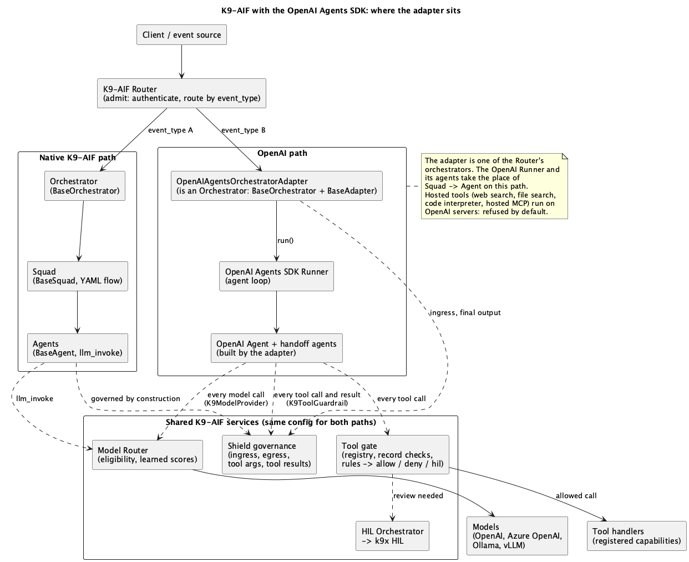
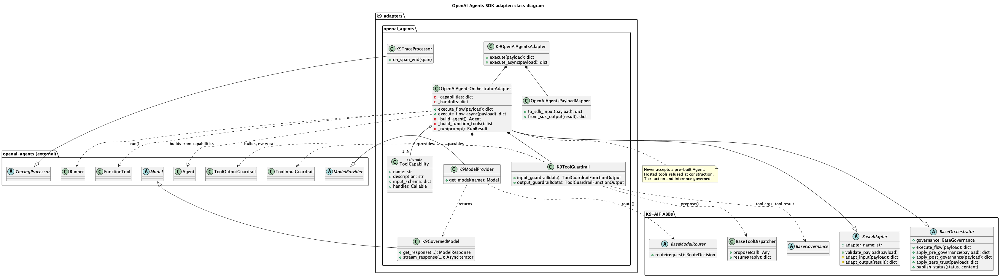

# Integration design: K9-AIF with the OpenAI Agents SDK

How the K9-AIF framework and the OpenAI Agents SDK work together, and what each one contributes.
The working example is described in [example-implementation.md](example-implementation.md).

Versions checked: openai-agents 0.24.0, k9-aif framework `main` (the adapter is merged; it ships to PyPI
in the 1.27.0 release).

## 1. What the OpenAI Agents SDK provides

From the SDK's own documentation ([openai.github.io/openai-agents-python](https://openai.github.io/openai-agents-python/)):

| Feature | What it does | Source |
|---|---|---|
| Agent loop | `Runner.run()` calls the model, runs tools, repeats until a final answer | [docs home](https://openai.github.io/openai-agents-python/) |
| Handoffs | "Handoffs allow an agent to delegate tasks to another agent." | [handoffs](https://openai.github.io/openai-agents-python/handoffs/) |
| Guardrails | Input guardrails on the user input, output guardrails on the final output, tool guardrails on `FunctionTool` | [guardrails](https://openai.github.io/openai-agents-python/guardrails/) |
| Approvals | `needs_approval` pauses a run; `RunState.approve()` / `reject()` resumes it | [human in the loop](https://openai.github.io/openai-agents-python/human_in_the_loop/) |
| Tracing | On by default, exported to OpenAI's backend; custom processors allowed | [tracing](https://openai.github.io/openai-agents-python/tracing/) |
| Models | Any OpenAI-compatible endpoint, per agent (`Agent.model`), per run (`ModelProvider`) or globally | [models](https://openai.github.io/openai-agents-python/models/) |

These are good building blocks. Each application decides which guardrails to attach and what they check.

## 2. Where an enterprise needs more

Read closely, the same pages show the edges:

- **First and last only.** "Input guardrails run only for the first agent in the chain" and output
  guardrails "only for the agent that produces the final output". Agents in the middle of a handoff chain
  have neither.
- **Hosted tools and handoffs are outside the tool guardrails.** Hosted tools (web search, file search,
  code interpreter, hosted MCP, image generation) "do not use this guardrail pipeline", and tool guardrails
  "do not apply to the handoff call itself". Hosted tools "execute for the model on OpenAI servers".
- **Traces leave by default.** The default processor exports spans "to the OpenAI backend".
- **A paused run is not authenticated.** `RunState.from_json()` does "not authenticate the snapshot or
  the person submitting it".
- **One SDK is rarely the whole estate.** The same company runs CrewAI, LangGraph, Claude sessions and its
  own services; guardrails written inside each one drift apart.

None of these is a flaw. The SDK is a library; these are enterprise concerns. That is the layer K9-AIF
supplies.

## 3. Where the adapter sits

`OpenAIAgentsOrchestratorAdapter` extends `BaseOrchestrator` and `BaseAdapter`, so it **is** an
orchestrator. The Router sends it an `event_type` exactly as it would any other orchestrator. On that path
the SDK's Runner and its agents take the place of Squad and Agent. Shield, Zero Trust, the tool gate, human
review and the Model Router are shared by both paths and read the same configuration.

The package follows the shape of every K9-AIF adapter:

| Class | Role |
|---|---|
| `K9OpenAIAgentsAdapter` | Facade: K9-AIF payload in, K9-AIF result out |
| `OpenAIAgentsOrchestratorAdapter` | Builds the agents and tools, governs the run |
| `OpenAIAgentsPayloadMapper` | Payload to SDK input; `RunResult` to `{status, result, output_text}` |
| `K9ModelProvider`, `K9GovernedModel` | The K9 Model Router as the SDK's model provider |
| `ToolCapability` | One tool the adapter brokers (shared with the Claude Agent SDK adapter) |

## 4. What is checked, and where

| When | Mechanism | Check | A refusal |
|---|---|---|---|
| Before the run | adapter | Zero Trust (`apply_zero_trust`), then Shield ingress | The SDK never starts |
| Each agent's turn | `RunHooks.on_agent_start` | Zero Trust for action `openai_agent:<name>` | The run ends before the agent acts |
| Each tool call | tool input guardrail | Shield on tool name and arguments (`screen_tool_call`) | The tool doesn't run; the model is told |
| Each tool result | tool output guardrail | Shield on the result (`screen_tool_result`) | The model gets a "withheld" notice |
| Each model reply | `RunHooks.on_llm_end` | Shield egress on the reply text, every agent | The run ends |
| Each model call | `K9ModelProvider` | K9 Model Router, eligibility first | No eligible model: fails closed |
| After the run | adapter | Shield egress on the final output | The answer isn't returned |

There is no separate per-agent input check, on purpose. Everything that enters an agent's context was
checked where it entered: the request at ingress, each tool result at the tool, each agent's reply at
`on_llm_end`. Re-checking the growing history would repeat text, which Shield's `SemanticDriftCheck`
treats as a loop.

**Sole broker.** The adapter builds every `Agent` from agent YAML and every tool from a registered
`ToolCapability`. It never accepts a pre-built `Agent` or tool, so a hosted OpenAI tool can't be given to an
agent at all, and a tool or handoff name that isn't registered fails at construction.

## 5. Model choice: the difference from the Claude Agent SDK

The Claude Agent SDK takes the model as a fixed string and calls Claude itself. K9-AIF can govern what a
Claude session does, not which model thinks. The OpenAI SDK accepts a `ModelProvider`, and that seam lets
the adapter offer two modes:

| `model_routing` | Who picks the model | Notes |
|---|---|---|
| `k9` (default) | The K9 Model Router, for every model call | The agent's `model` is a catalog task. `tool_calling` is required for agents with tools. Confidential requests reach only models marked `confidential`. No eligible model: the call fails closed |
| `direct` | You: `model` is passed to the SDK, or to your own `ModelProvider` | Everything else above still applies |

With `k9`, the provider asks the router through `llm_route()`, the one place outside `llm_invoke()` allowed
to touch the router. The SDK then calls the chosen endpoint through `OpenAIChatCompletionsModel`, so every
eligible model must speak the OpenAI API and support tool calling: Ollama, vLLM, OpenAI. Other backends are
refused rather than called some other way.

## 6. Agents declared in K9-AIF agent YAML

The same format K9-AIF agents use, read by `load_agent_specs()`. There is no Python agent class.

| Agent YAML | OpenAI `Agent` |
|---|---|
| `name` | `name` |
| `description` | `handoff_description` |
| `role`, `goal`, `instructions` | `instructions`, joined in that order |
| `model` | `model`: a catalog task (k9) or a model name (direct) |
| `temperature`, `max_tokens` | `model_settings` |
| `tools` | `tools`: registered `ToolCapability` names only |
| `handoffs` | `handoffs`: agent names in the same folder, capped by `max_handoffs` |

## 7. Many agents: squads for structure, handoffs for autonomy

Inside one Runner, the model decides which agent works next. Ten agents in one Runner can't be reviewed
before they run, tested step by step, or said to have failed at a named step. Governance still holds (every
call is checked), but the order of work is invisible until afterwards.

| Work | Use |
|---|---|
| A known process: intake, check, decide, act, notify | A K9 squad: YAML flow, each agent governed, a failure stops at a named step |
| One step that needs the model to delegate, such as triage across two or three specialists | This adapter with handoffs, capped by `max_handoffs` (default 3) |
| Both | The Router sends each `event_type` to its own orchestrator; results chain through topics |

## 8. Failures and human review

- A tool handler's exception ends the run and reaches the caller with **its own type**. The SDK wraps
  handler errors in its `UserError`; the adapter raises the original instead, so a `RequiresHIL` from the
  tool gate, or a `PermissionError`, is still recognisable to the orchestrator that publishes reviews.
- With `security.tool_gate.enabled`, the run executes inside a gate session: a handler that calls an MCP tool
  through a `BaseConnector` is proposed to the dispatcher, and a review the SDK swallowed is raised again.
- Resuming after a person decides depends on the path:
  - **A squad of OpenAI agents (`K9OpenAIAgent`, k9-aif 1.29.0): the same OpenAI run resumes.** A tool
    marked `needs_approval` pauses the run; `OpenAIHILAdapter` saves its `RunState` in `PausedRunStore` and
    raises `RequiresHIL`, and the orchestrator publishes the review to K9X HIL. When the decision comes
    back, the adapter restores the state, records `approve()` or `reject()`, and `Runner.run` continues
    where it stopped. The accounts payable use case runs this way.
  - **This adapter (a handoff group) with the tool gate:** a review raised by the gate is resumed by the
    orchestrator running the stored tool call; the agent loop does not continue where it stopped.

## 9. Tracing

SDK trace export to OpenAI is off (`RunConfig.tracing_disabled=True`) unless `openai_agents.export_traces:
true`. The adapter reports agent turns, handoffs, model routes and calls, tool calls and results, and
every check as K9-AIF trace events, the same events every other K9-AIF component emits.

## 10. Limits

- Hosted OpenAI tools can't be used through the adapter.
- With `model_routing: k9`, only OpenAI-compatible models with tool calling are eligible.
- `openai-agents` needs `openai>=3`, and `crewai` (through `instructor`) needs `openai<3`: install them in
  separate environments. The framework's `all` extra therefore leaves `openai-agents` out.
- Streaming (`Runner.run_streamed`) is not wrapped yet.

## 11. Evidence

| Claim | Proof |
|---|---|
| Every governance point in section 4 | `k9_aif_abb/tests/test_openai_agents_adapter.py` in the framework (19 tests, the SDK's real Runner driven by its `ScriptedModel`) |
| It works against a real model | This example: `./run.sh --demo`, recorded in [example-implementation.md](example-implementation.md) |
